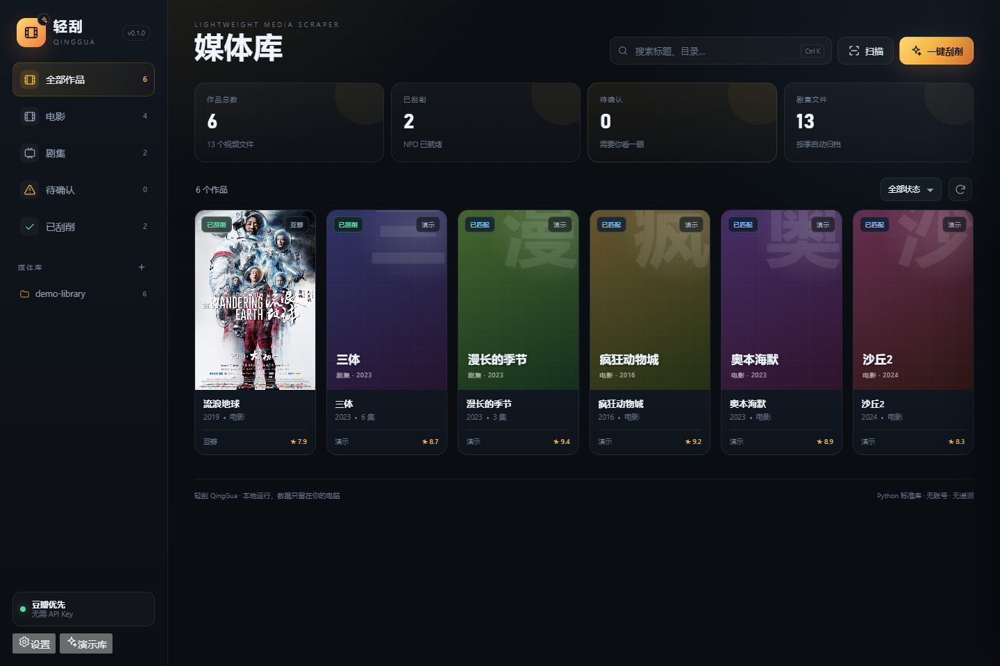
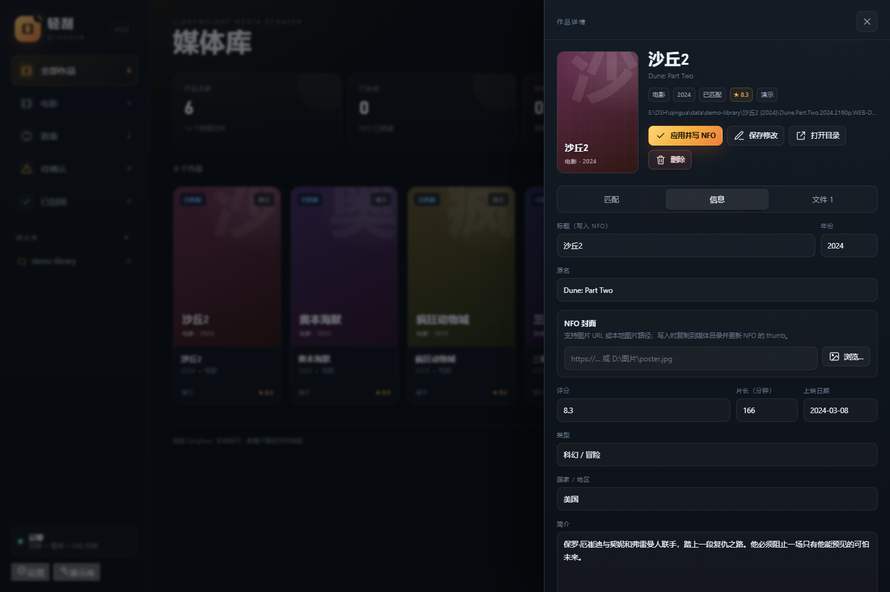

# 轻刮 QingGua

> 一个只做影视刮削的本地小工具。扫描目录，识别电影/剧集，匹配豆瓣或 TMDb，然后把海报、简介和 NFO 写回你的媒体库。





## 它是什么

轻刮不是播放器，也不是媒体库管理器。它只做一件事：

1. **扫描**：递归读取电影、剧集目录，跳过 sample、预告、临时文件。
2. **识别**：从文件名里解析片名、年份、季、集，兼容 `S01E02`、`第01集`、`1x02`、`EP01` 等写法。
3. **匹配**：豆瓣（免 Key）、番库（动漫优先）、哔哩哔哩（番剧）、TMDb（可选）四个来源；自动打分，低置信度进入“待确认”。
4. **写入**：下载海报/背景图，生成 Jellyfin / Emby / Kodi 通用 NFO，可选读取 ffprobe 媒体信息。
5. **整理**：可选按 `片名 (年份)/Season 01/片名 - S01E02.ext` 重命名，执行前先给完整预览。

它没有：播放器、账号、云同步、弹幕、下载、字幕、预告片、复杂插件市场。

## 为什么做它

我参照了两个现成软件，刻意做了减法：

| | 易影视 eVideo 3.2.0.13 | tinyMediaManager 5.0.13 | 轻刮 |
|---|---|---|---|
| 定位 | 影视库 + 播放器 | 全功能媒体管理器 | 只刮削 |
| 体量 | .NET 6 WPF，`eVideo.dll` 约 2.9 MB，静态清点 1,344 个类型、10,288 个方法 | Java，自带 JRE，`tmm.jar` 约 6.8 MB，十余个刮削提供方 | Python 标准库 + 原生 HTML/JS，零第三方依赖 |
| 刮削源 | 豆瓣、TMDb、猫眼、WMDb、So360 等，外加媒体库、播放器和字幕入口 | TMDb、IMDb、TVDb、TVMaze、AniDB、OFDb、Moviemeter、MPDB、FanartTV、Trakt、OpenSubtitles 等 | 豆瓣 + 番库 + 哔哩哔哩 + TMDb + 手动修正 |
| 输出 | 自家数据库 + NFO 等 | 元数据/艺术图/预告片/字幕，丰富的重命名 token | 元数据 + 海报 + NFO，一键完成 |
| 适合 | 想“一个软件全包” | 想精细控制每个字段和命名 | 想快速把文件刮干净 |

结论：**把“刮削”从“媒体中心”里拆出来**，保留最有用的 20%，去掉 80% 不常用的入口。详细参照记录见 [docs/REFERENCE.md](docs/REFERENCE.md)。

## 快速开始

要求：Windows 10/11，Python 3.10+（开发和测试使用 3.15.0）。无需安装任何 pip 包。

```powershell
cd E:\DSH\qingua
python app.py
```

或双击 `启动轻刮.bat`。浏览器会自动打开 <http://127.0.0.1:8787/>；端口被占用时会自动往后找。

第一次使用建议先点左下角 **演示库**，会生成 6 个作品、13 个视频文件的本地演示目录，不需要网络。

## 使用流程

1. 点 **添加媒体文件夹**，选择电影或剧集所在目录。也可以直接输入路径。
2. 点 **扫描**。轻刮会按目录自动分组：
   - `电影.2019.1080p.mkv` → 一部电影
   - `剧名/Season 01/剧名.S01E01.mkv` → 一部剧
   - `剧名/01.mkv`、`02.mkv` → 同一部剧的连续集
   - `[LoliHouse] Neko to Ryuu - 01/02/...`、`Yani Neko - 01/02/...` → 自动归为同一部剧
   - `[Airota][Majo no Tabitabi][01]`、`[Sakurato] Spy x Family [21]` → 识别方括号里的集数
   - 同一目录下文件名高度相似、只有一处数字不同（`01`/`02`/`03`）→ 自动聚成一部剧，不再要求固定写成 `SxxExx`
   - `Show/Season 01/...`、`Season 02/...` → 如果同时有多季，会拆成“剧名 第N季”两个作品，并归入同一系列
   - 主文件夹本身有多个季子目录时**不再作为作品**；`Shingeki no Kyojin` 这种父目录不会出现在作品列表，只有 S1/S2/最终季等子目录作品
   - `one punch man/S1/...`、`one punch man/S2/...` → 分别作为第 1、2 季作品，搜索时自动带上 `one punch man` 前缀
   - 只有一个 `Season 01` 子目录时仍作为一个整剧处理
   - `EVA新世纪福音战士/旧TV+剧场版/01.mkv` → 主文件夹是作品名，子文件夹只作为季/系列标签，作品仍叫 `EVA新世纪福音战士`
   - `SPs`、`Specials`、`EXTRA`、`Menu`、`NCOP`、`NCED`、`PV`、`CM`、`OAD`、`OVA` 等特典目录/文件默认跳过，避免把几百个菜单和预告当正片
3. 多季作品**不会自动写入**：打开详情后先在“匹配”里选择季，再搜索、确认。
   选择季时会按本季文件集数做粗筛，集数一致/接近的候选排前面；例如 25 集的季不会被 12 集的季候选挤掉。
   单季的 `S02` 会按第 2 季搜索，剧名中的“第一季/Season 1”会自动去掉，单集 NFO 仍保留 `S02Exx`。
4. 在作品卡片上点开详情：
   - **匹配**：搜索、选候选、应用；可选自动 / 豆瓣 / 番库 / 哔哩哔哩 / TMDb。
   - **信息**：手动修正标题（写入 NFO）、NFO 封面（图片 URL 或本地路径）、年份、简介等。
   - **文件**：查看集数、NFO 状态，预览 NFO 或整理文件。
5. 点 **一键刮削**：只处理“未匹配”。高置信度直接写入，低置信度标为“待确认”，不会硬塞错误结果；多季作品会被标为待确认并跳过。
6. 写入后，媒体库可以直接被 Jellyfin / Emby / Kodi 读取。

## 系列归纳

左栏会多出一个“系列”区域。它按标题识别续集/系列作品，例如：

- `钢铁侠1`、`钢铁侠2`、`钢铁侠 3` → `钢铁侠` 系列
- `流浪地球`、`流浪地球2` → `流浪地球` 系列
- `EVA新世纪福音战士新剧场版1/2/3` → `EVA新世纪福音战士新剧场版` 系列
- `one punch man 第1季`、`one punch man 第2季` → `one punch man` 系列；刮削后会变成“一拳超人第一季/第二季”

点系列名只看这个系列的作品；点“全部作品”退出。识别是本地按标题做的，不需要联网；同一个标题的不同版本（例如同一部电影的 1080p/2160p 两个文件）不会被硬凑成系列。

## 刮削源

### 豆瓣（默认，免 Key）

使用豆瓣移动端的公开 JSON 接口：

- 搜索：`movie.douban.com/j/subject_suggest`
- 详情：`m.douban.com/rexxar/api/v2/movie/{id}`

返回标题、原名、年份、简介、评分、类型、国家、片长、导演、演员、海报等。默认请求间隔 0.35 秒，并做 6 小时搜索缓存 / 24 小时详情缓存。

> 这是非官方接口，豆瓣可能随时调整或限流。轻刮会明确显示错误，不会静默失败。

### 番库（动漫优先，免 Key）

适合 `Neko to Ryuu`、`Yani Neko` 这类英文/罗马音命名的动漫。抓取服务端渲染的搜索页和详情页：

- 搜索：`fankuhub.com/anime?q=...`
- 详情：`fankuhub.com/anime/{id}`

只取用户需要的五项：**封面、剧名、集数、简介、年份**，不抓角色、Staff、评分等扩展字段。搜索页有缓存，详情请求之间留了间隔；如果触发站点的人机校验，会提示稍后再试。

### 哔哩哔哩（番剧，免 Key）

仿照 eVideo 的 B 站入口，但只用于番剧元数据：

- 搜索：`api.bilibili.com/x/web-interface/search/type?search_type=media_bangumi`
- 详情：`api.bilibili.com/pgc/view/web/season?season_id=...`

会先取访客 `buvid3`，再请求搜索；遇到 412 风控会刷新访客标识重试一次。可拿到封面、剧名、集数、简介、年份，以及每集标题（写入单集 NFO）。

### TMDb（可选，需要自己的 Key）

TMDb 在国内通常需要代理/VPN；它和豆瓣是两套数据，适合豆瓣限流、外语片或需要背景图的情况。

1. 注册 [themoviedb.org](https://www.themoviedb.org/)，到 **Settings → API** 创建一个 Developer API Key，复制 **API Key (v3 auth)**。
2. 在 **设置 → 刮削源** 打开 TMDb，粘贴 Key；API 地址保持 `https://api.themoviedb.org/3`，图片地址保持 `https://image.tmdb.org/t/p`。
3. 如果 VPN 是 **TUN/全局模式**：不用填 HTTP 代理，直接保存即可。
4. 如果 VPN 只提供 **HTTP 代理**：在 **设置 → 网络 → HTTP 代理** 填：
   - Clash / Mihomo：`http://127.0.0.1:7890`
   - v2rayN：`http://127.0.0.1:10809`（这是 HTTP 端口；10808 通常是 SOCKS，轻刮不支持 SOCKS）
   - 其他软件看它的“HTTP 代理/混合端口”，不要填 SOCKS 端口。
5. 检验：浏览器打开
   `https://api.themoviedb.org/3/configuration?api_key=你的Key`
   能返回 JSON 就说明 Key 和网络都通；打不开就把代理设为 TUN 或换 HTTP 端口。
6. 自动模式下顺序是 **豆瓣 → 番库 → 哔哩哔哩 → TMDb**；豆瓣限流/失败会继续尝试后面的来源。也可以把默认来源直接设为 TMDb。

注意：

- **项目不内置、不分享任何 API Key。**
- Key 只保存在本地 SQLite，界面不会回显。
- 图片下载也会走同一个 HTTP 代理；如果元数据能拉到但海报 404/超时，通常是 `image.tmdb.org` 被挡，仍用 TUN 或 HTTP 代理即可。
- TMDb 的剧集搜索通常返回整部剧，不像豆瓣那样按季返回；多季作品的“按集数粗筛”主要对豆瓣/番库/B 站更有效。

### 自动兜底

来源选“自动”时：先查豆瓣；没有结果再查番库；再查哔哩哔哩；最后查 TMDb（如果已启用且有 Key）。所有候选按标题、别名、年份、类型、评分综合打分。动漫条目即使文件名是英文/罗马音，也会用番库的 `titleRomaji` 做别名匹配。

### 手动改 NFO

在作品详情的“信息”页：

- **标题（写入 NFO）**：直接修改 NFO 的 `<title>`。
- **NFO 封面**：填图片 URL，或点“浏览…”选本地 jpg/png/webp；保存后点“应用并写 NFO”，会把图片复制到媒体目录，并更新 `<thumb>`。

## 输出规则

### 电影

```text
流浪地球 (2019)/
├─ 流浪地球.2019.1080p.BluRay.x264.mkv
├─ 流浪地球.2019.1080p.BluRay.x264.nfo
├─ 流浪地球.2019.1080p.BluRay.x264-poster.jpg
└─ 流浪地球.2019.1080p.BluRay.x264-fanart.jpg   # 有背景图时
```

### 剧集

```text
三体 (2023)/
├─ tvshow.nfo
├─ poster.jpg
├─ fanart.jpg
└─ Season 01/
   ├─ 三体.S01E01.2160p.WEB-DL.mkv
   ├─ 三体.S01E01.2160p.WEB-DL.nfo
   └─ ...
```

- NFO 为 Kodi v17+ 结构，包含 `uniqueid`、`ratings`、`genre`、`country`、`actor`、`fileinfo/streamdetails` 等。
- 默认 **不覆盖** 已有 NFO；手动修改或在详情页重新应用某个匹配时，会强制更新当前条目的 NFO。
- 海报优先保存为 `.jpg`；如果图源返回 PNG/WebP，会按真实格式保存并在 NFO 中引用。
- ffprobe 可选。设置里留空会自动找 PATH 或常见安装位置；找不到只提示，不影响刮削。

## 设置

| 设置 | 说明 |
|---|---|
| 默认来源 | 自动 / 豆瓣 / 番库 / 哔哩哔哩 / TMDb |
| 豆瓣、番库、B 站 | 免 Key；可分别关闭 |
| TMDb | 需要 Key |
| API 地址、图片地址 | 可换成反代或镜像 |
| HTTP 代理 | 形如 `http://127.0.0.1:7890` |
| 图片代理前缀 | 可选；支持 `{url}` 占位符，否则自动拼接 |
| 请求超时 | 默认 20 秒 |
| 写入 NFO / 下载海报 | 可单独关闭 |
| 覆盖已有 NFO / 海报 | 默认 NFO 不覆盖，海报覆盖 |
| 读取媒体信息 | 需要 ffprobe |
| 置信度阈值 | 默认 82；低于阈值进入待确认 |

## 项目结构

```text
qingua/
├─ app.py                  # 入口：解析参数、启动本地服务
├─ qingua/
│  ├─ server.py            # 标准库 HTTP 服务 + JSON API + 静态文件
│  ├─ core.py              # 扫描、搜索、应用、批量任务、演示库
│  ├─ db.py                # SQLite：目录、作品、文件、设置、缓存、任务
│  ├─ parser.py            # 文件名解析（电影/剧集/季集/年份/清洗）
│  ├─ scanner.py           # 目录遍历、分组、sample 过滤
│  ├─ providers.py         # 豆瓣 / TMDb 客户端、缓存、错误处理
│  ├─ matching.py          # 候选打分与自动选择
│  ├─ nfo.py               # 电影 / 剧集 / 单集 NFO
│  ├─ artwork.py           # 图片下载、格式识别、缓存
│  ├─ organize.py          # 重命名/整理计划与执行
│  ├─ probe.py             # 可选 ffprobe
│  └─ config.py            # 默认配置、路径、扩展名
├─ web/                    # 无构建步骤的前端
│  ├─ index.html
│  ├─ styles.css
│  └─ app.js
├─ tests/                  # unittest：解析、匹配、NFO、扫描、服务
└─ docs/                   # 截图与参照记录
```

数据默认保存在项目下的 `data/`：

- `qingua.db`：索引、设置、缓存、任务
- `cache/images/`：图片缓存
- `demo-library/`：演示目录
- 可用环境变量 `QINGUA_DATA` 改到其他位置。

## HTTP API

服务只监听 `127.0.0.1`，默认端口 8787。常用接口：

| 方法 | 路径 | 说明 |
|---|---|---|
| GET | `/api/bootstrap` | 设置、统计、目录 |
| GET | `/api/works?status=&kind=&q=` | 作品列表 |
| GET | `/api/works/{id}` | 作品详情、文件、元数据 |
| POST | `/api/works/{id}/search` | 搜索候选 |
| POST | `/api/works/{id}/apply` | 应用候选并写 NFO/图片 |
| PATCH | `/api/works/{id}` | 手动保存元数据 |
| POST | `/api/works/{id}/organize` | 整理预览/执行 |
| POST | `/api/jobs/auto` | 一键刮削任务 |
| GET | `/api/jobs/{id}` | 任务进度 |
| POST | `/api/demo` | 生成演示库 |
| POST | `/api/dialog/folder` | 打开系统文件夹选择器 |

## 测试

```powershell
cd E:\DSH\qingua
python -m unittest discover -s tests -v
```

覆盖：

- 文件名解析：年份、SxxExx、第 x 集、纯数字集、网站/压制组清洗
- 扫描分组：电影、按季剧集、纯数字连集、同目录 `- 01/02/...` 连集、方括号 `[01]`、仅数字不同的相似文件名、sample 过滤
- 特典过滤：SPs / EXTRA / Menu / NCOP / NCED / PV / CM / OAD / OVA
- 季识别：单季 S02 按第二季搜索、剧名去掉季后缀、多季作品强制待确认、按本季集数粗筛候选
- 季目录：`S1`/`S2` 拆成独立季作品，搜索带主文件夹前缀，并归入同一系列
- 嵌套目录：主文件夹作为作品名，子文件夹作为季/系列标签
- 系列归纳：`钢铁侠1/2/3`、`流浪地球/2` 归到同一系列
- 候选打分：精确标题、别名、年份偏差、类型不匹配、同分保护
- 番库页面数据解析：搜索列表、详情简介
- NFO：电影、剧集、单集 XML 结构
- 服务层：扫描、重扫迁移、应用 NFO、手动标题与本地封面、删除失效文件
- HTTP：健康检查、演示库、静态页面

## 已知限制

- 多季作品目前共用一个 `tvshow.nfo`：自动刮削会跳过，需手动选季确认；单集 NFO 的 `<season>` 仍按文件名里的 SxxExx 写入。
- `SPs`、`EXTRA`、`Menu`、`NCOP`、`NCED`、`PV`、`CM`、`OAD`、`OVA` 等特典默认跳过，避免刷出大量非正片条目；如果某个作品把正片放在这些目录里，需要单独处理。
- 豆瓣详情接口是非官方的，可能变化；请控制批量规模，不要高频请求。
- 番库会做人机校验；短时间大量搜索/详情会临时被拦，等几十秒再试，或先用 B 站/TMDb。
- B 站也有 412 风控；已做访客标识刷新和一次重试，但不保证所有网络环境都可用。
- 豆瓣不提供每集标题，剧集 NFO 的单集标题会写成“第 N 集”；B 站可以补上分集标题，TMDb 分集标题目前未接入。
- 不做预告片、字幕、演职员头像下载、播放进度、媒体库同步。
- 整理/重命名没有自动撤销；执行前一定看预览。
- NFO 字段覆盖主流播放器常用项，但不追求 100% 复刻 tinyMediaManager 的全部字段。
- 图片可能为 JPG/PNG/WebP；个别老播放器对 WebP 支持不佳，可在设置里关闭“覆盖已有海报”后手动替换。

## 隐私

- 服务只绑定 `127.0.0.1`，不接受局域网访问。
- 没有账号、遥测、云端数据库。
- TMDb Key 只保存在本地 SQLite；界面返回时会被清空，只显示“已保存”。
- 刮削请求只发往豆瓣、番库、哔哩哔哩、TMDb 及你配置的代理。

## 参照与证据

- 易影视 eVideo 3.2.0.13：REA 静态清点 `eVideo.dll`（SHA-256 `1553de…cb2f`），确认 .NET 6、WPF、1,344 types / 10,288 methods，以及豆瓣/TMDb/猫眼等 scraper 命名空间；未加载或执行目标程序。
- tinyMediaManager 5.0.13：检查 `version`、`tmm.jar` 条目和 `messages_zh.properties`，确认其多提供方、元数据/艺术图/预告片/字幕模块和重命名 token 体系；未运行目标程序。

详细记录见 [docs/REFERENCE.md](docs/REFERENCE.md)。
